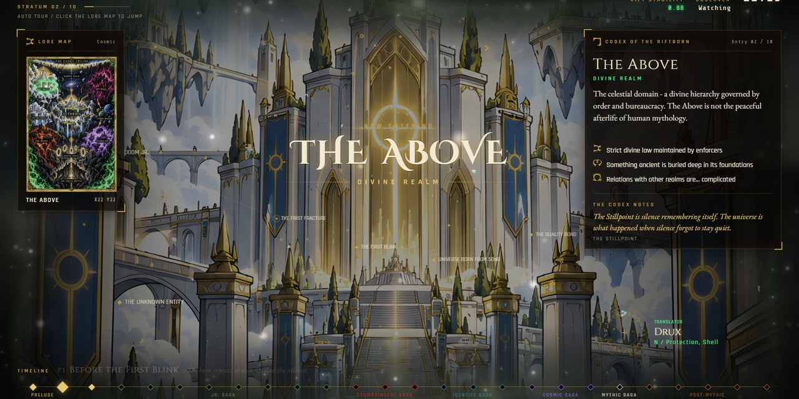
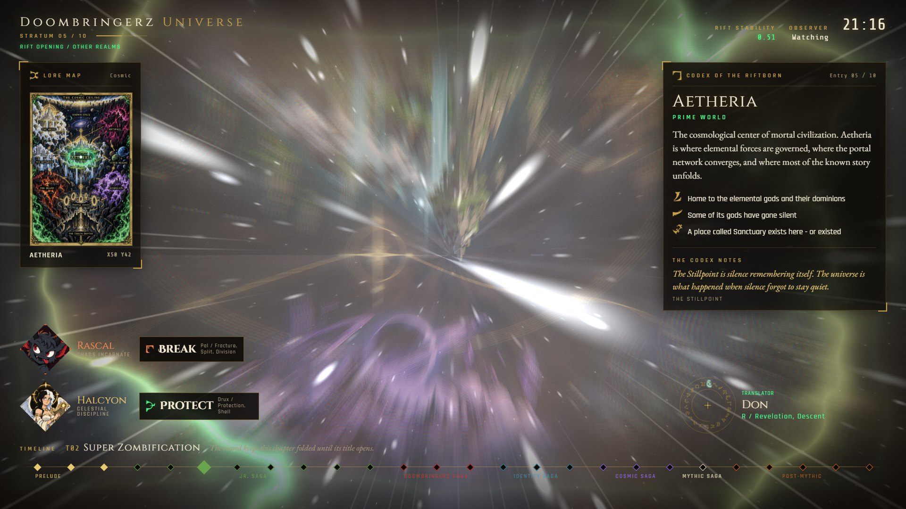

# Doombringerz Universe

A live wallpaper for Wallpaper Engine. You fly down through the Doombringerz Universe, realm by realm, from the Cosmic Ceiling to the Origin Depths. Then it loops.

## What's in it

- **Ten realms** from the Lore Map, upscaled to 4K.
- **Zones.** Inside a realm the tour stops at a zone or two. Sealed zones stay sealed.
- **Codex.** Every realm and zone gets its entry, plus a line from the Codex itself.
- **Timeline.** Every title, by saga. Folded titles stay folded.
- **Translator.** Realm names come in as Enochian glyphs and decode. The mouse reads glyphs too.
- **Rascal and Halcyon** trade one Enochian word every third realm.
- **Live unsealing.** When something opens on doombringerz.com, it opens here too.

## Two ways to fly

- **Auto** tours the realms by itself.
- **Interactive** waits for you. Click anywhere for waypoints, click a zone to fly in, steer with the mouse, scroll to push in. It can go back to touring after a while. Your call, it's a slider.

## Install

1. Code, Download ZIP. Unzip it.
2. Copy the folder into `<Steam>\steamapps\common\wallpaper_engine\projects\myprojects\`.
3. Open Wallpaper Engine. It's under Installed. Settings are in the panel on the right.

Steam Workshop: not yet.

It also runs as a plain web page. Open `index.html` in a browser and put the settings in the URL, like `index.html?mode=interactive&realm=aetheria`. Audio only reacts inside Wallpaper Engine.

## Will it eat my GPU

About 3 ms a frame at 1080p and 7 ms at 3440x1440, measured on a laptop RTX 3080. By default Wallpaper Engine pauses it while a game runs fullscreen. Still too much? Set Render quality to Low.

## Online

Live unsealing loads two public files from doombringerz.com: the timeline and the Codex. Once at start, then every 6 hours. No tracking, and it sends nothing of its own. The site sees a normal request, same as any visit. Turn Live unsealing off and it never goes online.

## Licence

The code is MIT, see [LICENSE](LICENSE). The art, the lore and the glyphs are not. What's covered and what isn't: [NOTICE.md](NOTICE.md).

Made by [Doombringerz](https://doombringerz.com).
