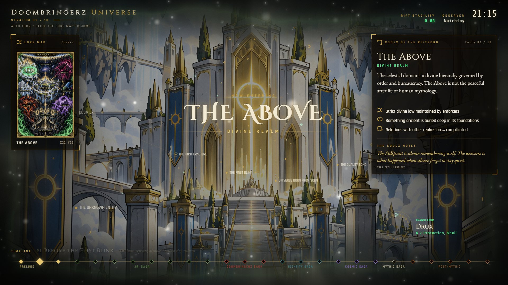
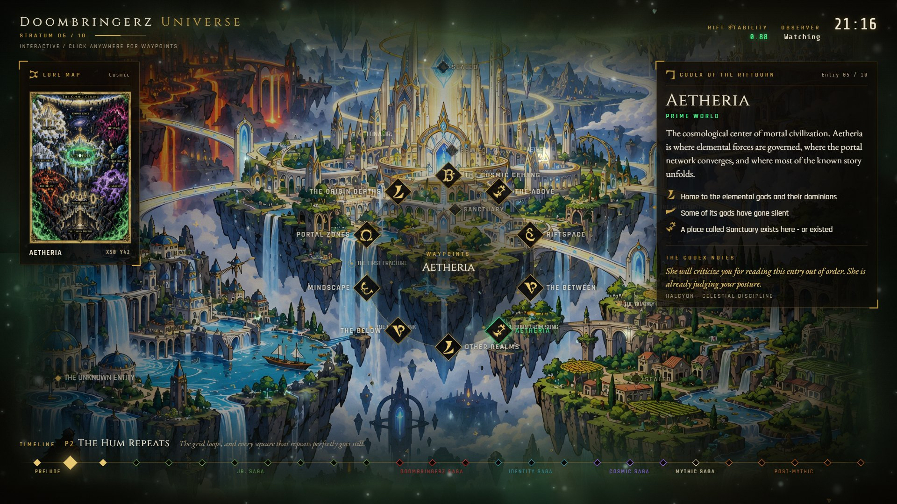
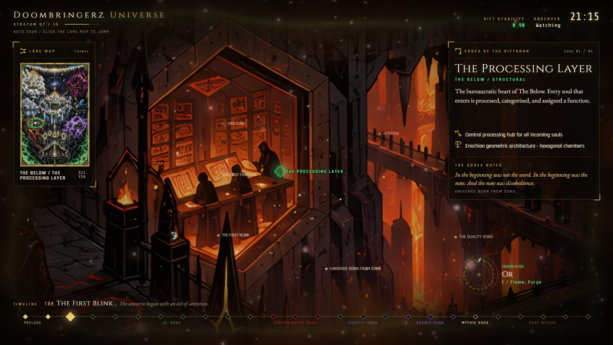

# Doombringerz Universe

A live wallpaper for Wallpaper Engine. You fly down through the Doombringerz Universe one realm at a time, from the Cosmic Ceiling all the way to the Origin Depths. Then it starts over.

## What's in it

- **Ten realms** from the Lore Map, upscaled to 4K.
- **Zones.** The tour stops at a zone or two inside each realm. Zones that are still sealed only show up as sealed.
- **Codex.** Every realm and zone shows its Codex entry, plus a quote from the Codex.
- **Timeline.** All the titles, sorted by saga. The ones that haven't released yet stay folded.
- **Translator.** Realm names show up in Enochian first, then decode into English. Your mouse carries a little translator too that reads out glyphs as you move.
- **Rascal and Halcyon** pop up every third realm and say one word to each other in Enochian.
- **Live unsealing.** More on that below.

## Auto or Interactive

- **Auto** flies the tour by itself.
- **Interactive** waits for you. Click anywhere to get waypoints, click a zone to fly into it, steer with your mouse and scroll to zoom in. If you leave it alone for a while it can go back to the tour by itself. You set how long (or never) in the settings.

## Install

1. Click Code, then Download ZIP, and unzip it.
2. Copy the folder into `<Steam>\steamapps\common\wallpaper_engine\projects\myprojects\`.
3. Open Wallpaper Engine. You'll find it under Installed. All the settings are in the panel on the right.

It's not on the Steam Workshop yet.

You can also just open `index.html` in your browser. The settings go in the address then, like `index.html?mode=interactive&realm=aetheria`. Reacting to audio only works inside Wallpaper Engine though.

## Will it eat my GPU?

Not much. On a laptop RTX 3080 it takes about 3 ms per frame at 1080p and about 7 ms at 3440x1440. Wallpaper Engine also pauses it when you're playing a game in fullscreen, unless you changed that setting. If it's still too heavy for you, set Render quality to Low.

## Live unsealing

A lot of the Doombringerz Universe is still sealed. Titles on the timeline and entries in the Codex stay folded until they release, and they open up one by one over time.

Live unsealing keeps the wallpaper up to date with that. When it starts, and then every 6 hours, it checks the public timeline and Codex on doombringerz.com. If something opened there, it opens in the wallpaper too. You don't need to update anything.

That's the only reason it goes online. It just downloads those two files, nothing gets uploaded. If you'd rather keep it offline, turn Live unsealing off in the settings. It'll show what it came with.

## Licence

The code is MIT, see [LICENSE](LICENSE). The art, the lore and the glyphs aren't. You can't reuse those. [NOTICE.md](NOTICE.md) lists exactly what's covered and what isn't.

Made by [Doombringerz](https://doombringerz.com).
